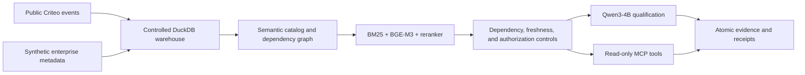
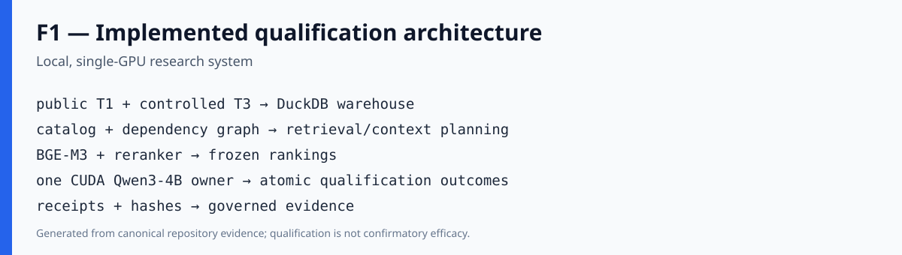
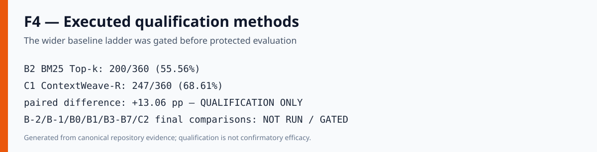
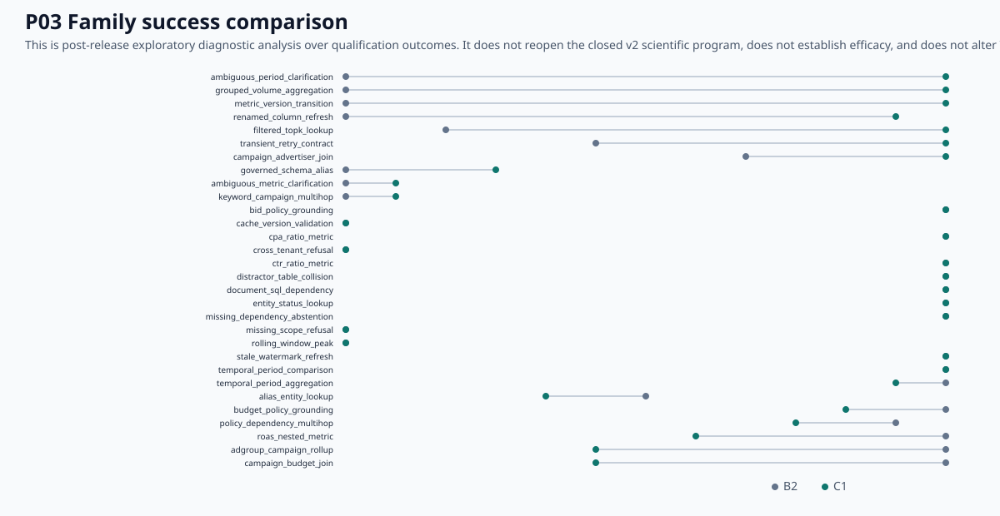

# ContextWeave-MCP

**Evidence-First Adaptive Context Optimization for Tool-Using Agents over Structured Enterprise Data**

[](https://github.com/ReviveCoding/ContextWeave-MCP/actions/workflows/ci.yml)
[](https://www.python.org/)
[](https://github.com/ReviveCoding/ContextWeave-MCP/releases)

## Overview

ContextWeave-MCP is a research and portfolio system for selecting compact, governed context for analytical agents. It combines lexical and neural retrieval, reranking, schema and metric dependency closure, freshness and authorization controls, read-only SQL, and Model Context Protocol (MCP) tools over a controlled enterprise-style data environment.

The repository preserves the complete scientific record, including negative results. The v2 study stopped before a protected benchmark because the calibrated design could not reach its prespecified power target within the 600-task feasibility ceiling.

## Research question

Can dependency-aware, utility-aware, and freshness-aware context selection supply an analytical agent with enough evidence to answer correctly while controlling token use, latency, stale context, missing dependencies, and authorization risk?

The planned confirmatory hypothesis required non-inferior task success and materially lower context use. That hypothesis was **not tested**: the project closed at the qualification and power-planning gate.

## Why ContextWeave

Enterprise analytical questions depend on more than semantic similarity. Correct answers may require exact schema versions, join paths, governed metric definitions, policy documents, tenant scope, and data-freshness state. ContextWeave-R therefore combines retrieval with deterministic dependency closure and governance checks before constructing model context.

## System architecture





## Data and warehouse scale

| Evidence domain | Audited scale |
|---|---:|
| Public event rows | 16,468,027 |
| Public-data users | 6,142,256 |
| Campaigns | 675 |
| Controlled warehouse tables | 36 |
| Controlled warehouse columns | 425 |
| Governed metrics | 7 |

The event source is the public Criteo Attribution Modeling for Bidding dataset. Raw row-level source data is excluded from Git. The enterprise warehouse combines public event structure with explicitly controlled synthetic entities, policies, versions, permissions, and freshness state; it does not represent production advertiser systems or policy truth.

## MCP surface

Eight read-only MCP tools cover schema search and description, metric definitions, policy retrieval, freshness, analytical time series, query explanation, and sandboxed SQL. Qualification smoke tests passed through in-memory, stdio, and Streamable HTTP paths using MCP 2.2.0 and protocol `2026-07-28`.

These are local software checks. They are not production availability, performance, or security-certification evidence.

## Qualification benchmark

The v2 qualification set contains:

- 360 paired tasks in 30 semantic families, with 12 tasks per family;
- 240 checked executable gold-SQL tasks and 120 governed-behavior tasks;
- `ANSWER`, `CLARIFY`, `REFRESH`, `REFUSE`, `RETRY`, and `ABSTAIN` behaviors;
- lookup, joins, temporal aggregation, ratios, nested metrics, schema and metric changes, policy grounding, authorization, freshness, cache, and dependency stress;
- eight independently reviewed adversarial constructs, integrated without access to candidate internals.

The canonical task manifest SHA-256 is `38cc188a25252a4d7eb981f8a1d24b838aecc83686c24091ccba4c1e1a76ce99`.

## Headline qualification results

> **QUALIFICATION ONLY — these outcomes do not establish confirmatory efficacy.**

| Method | TaskSuccess | Rate |
|---|---:|---:|
| B2 BM25 Top-k | 200 / 360 | 55.56% |
| C1 ContextWeave-R | 247 / 360 | 68.61% |

- Observed paired qualification difference: **+13.06 percentage points**
- C1-only successes: **75**
- B2-only successes: **28**
- Net paired wins: **+47**

Both methods used the same 360 task identities and frozen Qwen3-4B revision. The positive qualification difference must not be presented as a statistically established improvement.



## Post-release robustness diagnostics

> **POST-HOC EXPLORATORY — these diagnostics do not reverse the E07 power-gate decision.**

The post-release diagnostic program used only stored qualification outcomes. Leave-one-family-out deltas ranged from approximately **+10.06 pp to +15.52 pp**. A deterministic 100,000-replicate family bootstrap produced exploratory `P(delta > 0) ≈ 95.54%`. Its percentile interval included zero, and neither result supplies confirmatory evidence.



## Error and slicing analysis

The exploratory reports include all semantic families, expected behavior, difficulty, source, schema and metric versions, task complexity, retrieval coverage, context-size bins, and normalized stored-output error classes. Operationally critical unsafe-answer diagnostics are reported explicitly; they are not a security certification. The engineering backlog treats subsystem assignments as hypotheses that require a new protocol to test.

- [Slice analysis](reports/posthoc/SLICE_ANALYSIS.md)
- [Error analysis](reports/posthoc/ERROR_ANALYSIS.md)
- [Retrieval and context analysis](reports/posthoc/RETRIEVAL_CONTEXT_ANALYSIS.md)
- [Improvement backlog](reports/posthoc/IMPROVEMENT_BACKLOG.md)

## Statistical governance and claim boundary

The original v2 E07 simulation was anti-calibrated and is preserved as `SUPERSEDED_INVALID_CALIBRATION`. The corrected family-level test passed calibration checks, then required 799 independent families for 0.90 analytic power. The best feasible design at or below 600 tasks reached simulated power 0.1165.

The scientific disposition is:

```text
V2_PRE_FREEZE_INSUFFICIENT_POWER_CALIBRATED
```

No protected benchmark was created or accessed. No design freeze or benchmark freeze exists. The repository supports no confirmatory efficacy, production deployment, production latency, production security certification, Amazon-internal, revenue/ROAS, distributed-performance, or external-generalization claim.

## Reproducibility

Python 3.12 and `uv.lock` define the software environment. CPU quality checks do not rerun neural inference or regenerate scientific outcomes.

```bash
uv sync --locked --no-extra gpu --group dev
uv run ruff format --check src tests scripts
uv run ruff check src tests scripts
uv run mypy --strict src/contextweave
uv run python -m pytest -q
uv run python scripts/audit_receipts.py --check-only
uv run python scripts/validate_release.py
uv run python scripts/validate_posthoc_v1.py
uv build
```

GPU reproduction is intentionally separate and documented in [the reproduction guide](reports/REPRODUCTION_GUIDE.md). Publication CI never downloads model weights or reruns retrieval or inference.

## Repository layout

```text
src/contextweave/       Core algorithms, MCP adapter, governance, and evaluators
tests/                  CPU software, evidence, and recovery regression tests
benchmarks/             Versioned qualification task definitions
evidence/               Compact receipts, hashes, outcomes, and derived diagnostics
reports/                Scientific, release, and post-hoc reports
figures/                Evidence-derived release and exploratory figures
scripts/                Resumable workflows and read-only validators
sources/                Source and license registry
```

## Quick start

```bash
git clone https://github.com/ReviveCoding/ContextWeave-MCP.git
cd ContextWeave-MCP
uv sync --locked --no-extra gpu --group dev
uv run contextweave --help
uv run python -m pytest -q
```

The default setup is CPU-only. Local neural qualification requires the optional `gpu` extra, pinned model revisions, the separately documented native WSL environment, and suitable NVIDIA hardware. It is not part of CI or the public release validation path.

## Reports and evidence

- [Final technical report](reports/FINAL_TECHNICAL_REPORT.md)
- [Executive summary](reports/EXECUTIVE_SUMMARY.md)
- [Claim ledger](reports/CLAIM_LEDGER.md)
- [Reproduction guide](reports/REPRODUCTION_GUIDE.md)
- [Post-hoc diagnostic report](reports/posthoc/POSTHOC_DIAGNOSTIC_REPORT.md)
- [Post-hoc claim ledger](reports/posthoc/POSTHOC_CLAIM_LEDGER.md)
- [Release quality receipt](evidence/quality/release_closure.json)
- [Post-hoc artifact manifest](evidence/posthoc_v1/manifest.json)

## Limitations

- Semantic families are designed clusters rather than a probability sample of analytical work.
- Only B2 and C1 qualification methods completed under v2.
- Context-efficiency, systems, security, cache, OOD, ablation, and external-transfer experiments were gated and not run.
- Recorded qualification timing is batch-level and is not production latency.
- Controlled warehouse structures cannot support production-advertiser conclusions.
- No confirmatory effect estimate exists.

## Citation and author

Author: **Jinwoo Bae** (`ReviveCoding`). Citation metadata is available in [`CITATION.cff`](CITATION.cff).

This repository does not currently grant a software license. Public availability does not itself grant permission to copy, modify, or redistribute the code beyond rights provided by applicable law.
